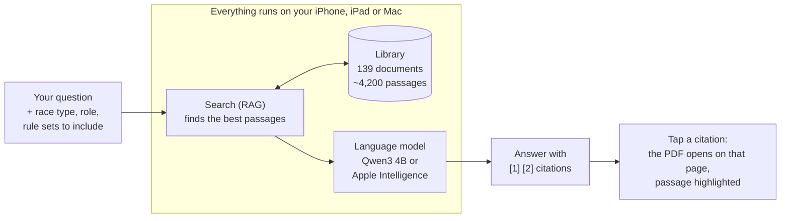

# How ARC (Alpine Racing Companion) works

This page explains, in plain terms, how the app turns a question like *"A gate judge was
standing in the racer's line. Can she get a re-run?"* into a short answer with links to the
exact pages of the rulebooks. No programming knowledge needed.

## The big picture

The app has three main parts, and each one does a single job:

| Part | Think of it as… | What it does |
|---|---|---|
| **The library** (database) | A very fast index at the back of a book | Holds every page of the 139 reference documents and forms, already split into short passages, and finds the passages that match a question in milliseconds. |
| **The search** (RAG) | A well-organised assistant who pulls the right pages off the shelf | Decides *which* 5–12 passages are worth reading for this question, taking the race type and your role into account. |
| **The language model** (LLM) | A careful colleague who reads those pages and summarises them | Reads only the passages it was handed and writes a short answer, citing each statement. |

Nothing leaves the device. The app works in airplane mode on the hill.

---

## 1. The library (the database)

Before the app is built, a script reads every document (the ACR and ICR rulebooks, the
Alpine Officials' Manual, the study guides, other FIS and U.S. Ski & Snowboard documents,
the OISRA rules, medical guides and the clinic slide decks) and prepares them for searching:

- **Splits them into passages.** Each passage is one section of a document, for example
  rule *623 Re-runs* in the ACR, *"Re-Runs"* in the OISRA rules, or *"Composition of the
  Jury"* in Chapter III of the Officials' Manual. Long sections are cut into pieces of about
  300 words. The ACR alone has about 860 numbered rules and the ICR about 1,100.
- **Remembers where each passage came from**: the document, the heading, and the page number
  as printed on the page (`p. 8`, `p. III/6`, `Slide 14`). That's what makes the citations
  exact.
- **Notes the rule numbers each passage mentions**, for example `[601.4.1]` in a study guide.
  Asking about "rule 601.4" then also finds the study-guide passages that discuss it.
- **Labels each document** with whose rules it carries (OISRA, U.S. Ski & Snowboard, FIS, or
  general reference) and which officials it's written for (Referee, Chief of Course, …).

All of this goes into a single small database file (about 5 MB) that ships inside the app,
next to the PDFs themselves. It uses **SQLite**, the same database built into every iPhone,
with its full-text search feature.

> **Why not a "vector database"?** Vector databases help when searching millions of
> passages. With about 4,200 passages, the phone can compare a question against every
> one of them in under a millisecond, so a plain SQLite file plus a small list of numbers is
> simpler and just as fast.

## 2. The search (RAG: retrieval-augmented generation)

"RAG" is a fancy name for a simple idea: **look things up first, then answer**. Language
models that run on a phone are small. They don't reliably *know* ski racing rules, and if
asked from memory they may invent plausible-sounding but wrong ones. So the app never asks
the model to answer from memory. It first retrieves the relevant passages and hands the
model only those.

The search combines several ways of finding passages and then merges the results:

1. **Exact rule numbers.** "What does 614.2 say?" goes straight to rule 614.2.
2. **Keywords**, like a book index, including racing shorthand: *TD* also finds "technical
   delegate", *GS* also finds "giant slalom", *DNF* also finds "did not finish".
3. **Passages that contain every key word** of the question, to favour precise matches.
4. **Meaning.** Apple's built-in language tools turn each passage into a "fingerprint" of
   its meaning, so *"Can a racer redo the run if someone was in the way?"* finds the
   *"Re-Runs"* section even though the words differ.

It also **recognizes familiar questions**. The study guides are full of the exact questions
officials ask, each followed by the rule that answers it, e.g. *"Who can submit protests?
[645]"*. When a passage asks nearly the same question you did, it moves to the top. A section
whose heading names everything you asked about (like *FIS Homologated Gate Panels*) also
gets a lift.

Then it **follows citations**. Study guides and the Officials' Manual cite rules in
brackets, like *"Who can grant a rerun? [623.1.1]"*. When one of the top passages cites a rule
in the sentence most like your question, the search fetches that rule's own text from the ACR (or
from the ICR for a FIS race) and places it right after the passage that cited it. The model
then sees both the explanation and the rule itself.

Then it applies **your situation**:

- **Race type.** For an *Oregon High School (OISRA)* race, OISRA rules come first, because
  they supersede U.S. Ski & Snowboard and FIS rules. The best OISRA passages are always
  included when they're relevant.
- **Your role.** A Referee's question ranks the Referee study guide, the Referee clinic
  slides and Chapter III higher.
- **Rule sets to include.** Unchecked rule sets (for example FIS) are removed from the
  results entirely.

The best 5 to 20 passages (more for the larger model) go to the language model.

## 3. The language model (LLM)

The language model reads the numbered passages and writes the answer. It's given strict
instructions:

- Answer **only** from the numbered passages; never guess.
- Put the passage number after each statement, like **[2]**.
- Quote numbers, times and distances exactly.
- Mention rule numbers the passages cite, so you can look them up.
- If OISRA governs this race and conflicts with U.S. Ski & Snowboard or FIS, follow OISRA
  and say so.
- Focus on what *your role* has to do, and say when something is another official's job.

The app then checks the answer: any citation number that doesn't match a passage it actually
supplied is dropped, so every link opens a real page.

**Which model?** The app picks automatically (you can override it in Settings):

| Model | Where it runs | Notes |
|---|---|---|
| **Qwen3 4B** (open model, via Apple's MLX) | iPhone 15 Pro or newer, M-series iPad and Mac | Reads more passages at once (about 7,000–28,000 words' worth, depending on device memory), so answers draw on more sources. A one-time 2.3 GB download, then it works offline. |
| **Apple Intelligence** | Devices with Apple Intelligence turned on | No download, but it reads fewer passages (about 2,000 words). |
| **Search only** | Every device | No written answer; shows the most relevant passages with page links. |

## What happens when you ask a question

1. You type: *"A gate judge was standing in the racer's line. Can she get a re-run?"*, in a
   conversation set to **OISRA · Referee**.
2. **Search** finds OISRA *Re-Runs*, *Grounds for Interference* and *Validity of a Re-Run*
   (all page 8), plus related passages from the Referee study guide and the Officials'
   Manual. OISRA passages are marked as *governing*.
3. **The language model** reads those passages and writes: *"Yes. Under OISRA rules, an
   official blocking the race line is grounds for interference [2]…"*
4. The app shows the answer with tappable chips like **Re-Runs · p. 8**. Tap one, and the
   PDF opens at page 8 with the passage highlighted in yellow.

## Keeping it accurate

- **Updating documents.** Each season, drop the new PDFs into the document library
  (`ingest/library/documents/`, or `ingest/documents/` for your own copies) and run
  `scripts/build_resources.sh`. The library is rebuilt, and the app refreshes its meaning
  fingerprints automatically on first launch.
- **Tables.** PDF text extraction scrambles some tables (like the course-setting
  specifications), so those get a hand-checked text version in the library's `supplements/`.
- **Cross-references.** Some OISRA sections restate ACR rules without citing them, sometimes
  in looser words (OISRA's re-run "remains valid if it proves slower"; the ACR says "even if").
  `see_also` in `catalog.yaml` links such a section to its ACR rules, so the search brings the
  ACR text along and the model can read both.
- **Tests.** The project extracts the review questions from the officials' study guides
  (227 of them) and checks that every standalone question retrieves a passage that answers
  it (100%), and that when a guide cites a rule for a question, that rule's text from the
  ACR/ICR comes back too (100%, in the top 5). It also checks a set of everyday questions
  from officials (100% in the top 5).
- **Answers can still be wrong.** The model summarises; the cited page is the authority.
  The app is designed so you can check the source with one tap.

## Where things live in the code

| Folder | What's there |
|---|---|
| `ingest/` | The script that builds the library from the documents, the document catalog (`catalog.yaml`), and the tests. The documents themselves, the table supplements and the study-guide questions are in a separate private repository (`ingest/library/`), because they belong to their publishers. |
| `Packages/RulebookKit/` | The search, the race-type and role logic, and the connection to the language models. |
| `App/` | The screens: chat, library, PDF viewer and settings. |
