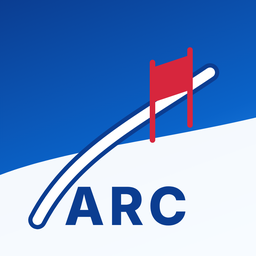
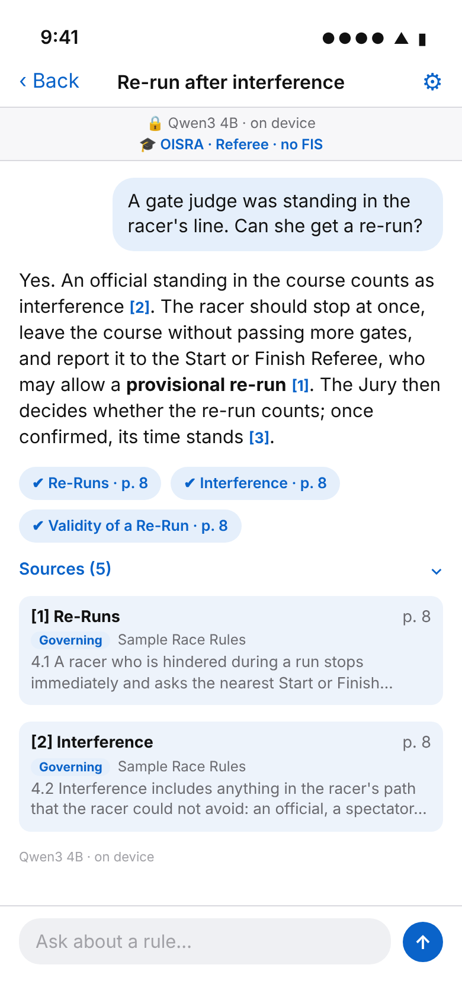
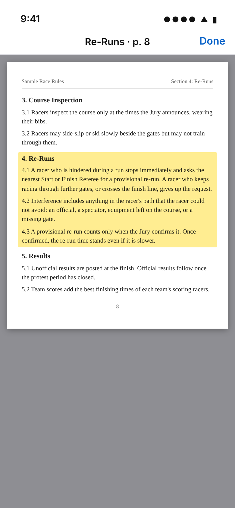
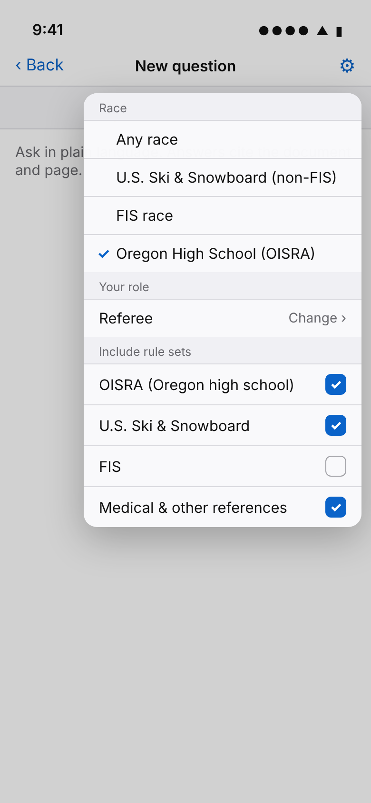
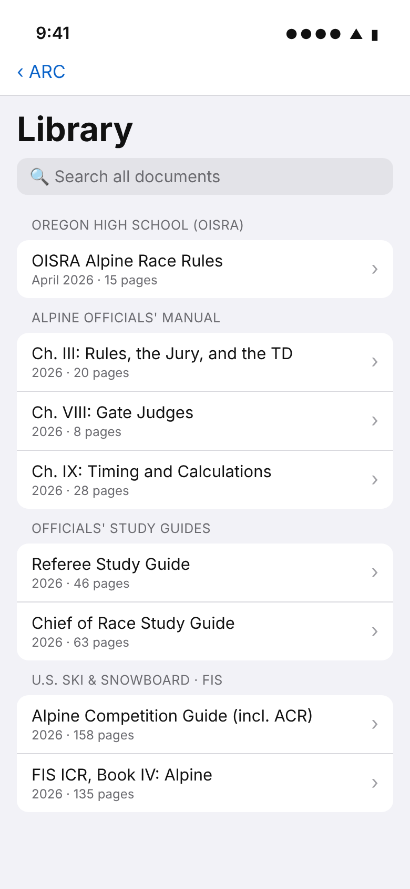

<p align="center">
  
</p>

# ARC: Alpine Racing Companion

*Ski racers arc their turns. Officials need answers, fast.*

**Ask a rules question in plain English. Get a short answer, with a link to the exact page it came from.**

ARC is an iPhone, iPad and Mac app for alpine ski race officials: Referees, Technical
Delegates, Chiefs of Course and Race, timing crews, gate judges and coaches. It knows the
rulebooks themselves, the **U.S. Ski & Snowboard Alpine Competition Regulations (ACR)** and the
**FIS International Ski Competition Rules (ICR)**, plus the **Alpine Officials' Manual**, the
**officials' study guides**, U.S. Ski & Snowboard and FIS specifications, the **OISRA**
(Oregon high school) race rules, medical and concussion guidance, and the clinic slide decks:
68 documents in all.

It runs entirely on your device. No signal on the hill? No problem.

> **The documents are not in this repository.** ARC's code is open source (MIT); the rulebooks
> belong to their publishers. See [Documents, copyright and trademarks](#documents-copyright-and-trademarks).

> The screenshots below are design mockups of the app's screens. To respect the publishers'
> copyright they show a made-up *Sample Race Rules* document, not real pages. See
> [Capturing real screenshots](#capturing-real-screenshots).

<table>
<tr>
<td width="25%"></td>
<td width="25%"></td>
<td width="25%"></td>
<td width="25%"></td>
</tr>
<tr>
<td><b>Ask anything.</b> Answers cite their sources, like <i>Re-Runs · p. 8</i>.</td>
<td><b>Check the source.</b> Tap a citation and the page opens with the passage highlighted.</td>
<td><b>Set the scene.</b> Pick the race type and your role, and tick which rule sets to include.</td>
<td><b>Browse.</b> Every document, section by section, plus search.</td>
</tr>
</table>

## What it's good at

- **Plain-language questions.** *"A gate judge was in the racer's line. Can she get a re-run?"*
  works as well as *"What does 601.4 say?"*.
- **Answers you can verify.** Every statement points to a numbered source. One tap shows the
  page.
- **The rule itself, not just the summary.** When a study guide or the Officials' Manual
  cites a rule ("[623.1]"), ARC also pulls that rule's text from the ACR (or the ICR for FIS
  races), so the answer quotes the actual rule.
- **The right rule book for the race.** Choose *Oregon High School (OISRA)* and OISRA rules
  come first: they supersede U.S. Ski & Snowboard and FIS rules, and the app says so when
  they differ. Running a club race? Untick FIS.
- **Answers for your job.** Tell it you're the Referee, Chief of Course or Timing chief, and
  answers focus on what *you* need to do, and say when something is another official's call.
- **Officials' shorthand.** TD, GS, SL, DNF, DSQ, EET and other common abbreviations are
  understood.
- **Works offline.** Everything, including the language model, runs on the device.

## How it works, in one paragraph

When you ask a question, the app first **searches** its built-in library of 68 documents
(about 3,600 passages) for the handful of passages that best match your question, race type
and role. It then hands **only those passages** to a small language model running on your
device, which writes a short answer and cites each passage it used. This approach is called
*retrieval-augmented generation* (RAG). It keeps answers grounded in the actual rules
rather than the model's memory. For the full plain-language explanation, see
**[ARCHITECTURE.md](ARCHITECTURE.md)**.

## Devices

| Your device | What you get |
|---|---|
| iPhone 15 Pro or newer, M-series iPad or Mac | Full written answers from **Qwen3 4B** (a one-time 2.3 GB download in Settings) or Apple Intelligence |
| Other devices with Apple Intelligence | Written answers from Apple Intelligence |
| Any device running iOS / iPadOS / macOS 26 | Search mode: the most relevant passages with page links |

## Getting ARC

ARC is shared through Apple's **TestFlight**: open the invitation link, install TestFlight,
and tap *Install*. It works on iPhone, iPad and Mac, and updates arrive automatically. To build
and share it yourself, see **[DISTRIBUTION.md](DISTRIBUTION.md)**.

---

## For developers

### Repository layout

```
ingest/                     Builds the searchable library from the documents
  library/                  PRIVATE submodule (maintainers only), not part of the public code:
    documents/              the 68 source documents (PDF, PPTX, PPT)
    supplements/            hand-checked text for tables PDF extraction scrambles
    eval/                   227 questions extracted from the study guides
  documents/                (git-ignored) put your own downloaded copies here instead
  catalog.yaml              title, collection, jurisdiction and roles for each document
  build_index.py            documents -> App/Resources/rulebook.sqlite + PDFs
  eval/                     retrieval evaluation and the everyday officials' question set
  tests/                    pytest suite (synthetic sample documents)
Packages/RulebookKit/       Swift package: search, race context & roles, LLM backends
App/                        SwiftUI app for iOS, iPadOS and macOS
docs/screenshots/           README images (mockups) and the page that renders them
docs/icon/                  the ARC app icon design (icon.html) and its renderer
project.yml                 XcodeGen project definition
scripts/build_resources.sh  rebuild the library and copy the PDFs into the app
scripts/bump_build.sh       next build number before each TestFlight upload
scripts/check_public.sh     run before committing: fails if a document or copied text is tracked
DISTRIBUTION.md             TestFlight: getting ARC onto iPhone, iPad, Macs and to other officials
```

### Build and run

You'll need a Mac with **Xcode 26**, [XcodeGen](https://github.com/yonaskolb/XcodeGen) and
Python 3.10 or newer, plus the reference documents (see
[Getting the documents](#getting-the-documents)):

```sh
brew install xcodegen
brew install --cask libreoffice     # converts the clinic slide decks to PDF
brew install ocrmypdf               # optional: makes scanned PDFs searchable

scripts/build_resources.sh          # builds App/Resources/rulebook.sqlite (~3 min)
xcodegen generate
open AlpineCompanion.xcodeproj
```

Set your signing team, then run on **My Mac** or a **real** iPhone/iPad. Qwen3 4B uses MLX,
which needs a real GPU, so it doesn't run in the iOS Simulator; there the app uses Apple
Intelligence or search mode.

### Adding or updating documents

1. Put the file in `ingest/library/documents/` (or `ingest/documents/` if you use your own
   copies). PDF, PPTX or PPT; original file names are fine.
2. If it's new, add an entry to `ingest/catalog.yaml` with a title, collection,
   jurisdiction (`oisra`, `usss`, `fis` or `reference`) and the roles it serves. Unknown
   files are still indexed under *Other References*, and the build prints a warning.
3. Run `scripts/build_resources.sh` and check the printed retrieval scores.
4. Rebuild the app. On first launch it notices the new library and refreshes its search
   data automatically.
5. Commit the document in the **library** repository, never in this one
   (`scripts/check_public.sh` catches mistakes).

### Tests

```sh
python3 -m pytest ingest/tests                 # pipeline tests, plus the retrieval gate once the library is built
python3 ingest/eval/eval_retrieval.py --db App/Resources/rulebook.sqlite --study-guides
cd Packages/RulebookKit && swift test          # search and answer logic (macOS 26)
```

The pipeline tests use small synthetic documents and run anywhere. The retrieval gate runs
once the real index is built, and checks three things against the real documents (the
study-guide checks also need the private library, since their questions are copied from the
guides):

- **Study-guide questions** (227 extracted automatically): every standalone question must
  retrieve an answering passage in the top 5. Currently 193/193; 34 follow-ups that only make
  sense in context are reported but not graded.
- **Cited rules:** when a study-guide question cites rules (e.g. "[601.3]"), the rule's own
  ACR/ICR passage must be in the top 5 (what Apple Intelligence reads) and the top 10.
  Currently 43/43 for both.
- **Everyday officials' questions** (`ingest/eval/questions.yaml`): every one must find an
  expected document in the top 5. Currently 33/33.

### Capturing real screenshots

The images above are mockups (`docs/screenshots/mockups.html`, rendered with
`docs/screenshots/render.js`). To replace them with real ones, run the app in the
iPhone 17 simulator or on a device and capture:

```sh
xcrun simctl io booted screenshot docs/screenshots/chat.png
```

Public screenshots must never show real document pages or quote the documents at length.

## Documents, copyright and trademarks

**ARC's code is open source** under the [MIT license](LICENSE). **The documents it searches
are not.** The rulebooks, manuals, study guides and clinic slides belong to their publishers:
U.S. Ski & Snowboard, the International Ski and Snowboard Federation (FIS), the Oregon
Interscholastic Ski Racing Association (OISRA), the U.S. Centers for Disease Control and
Prevention (CDC) and the British Journal of Sports Medicine (BJSM). None of them are in this
repository or its history, and the MIT license doesn't cover them.

ARC is an independent project by a volunteer official. It is **not affiliated with, endorsed
by or sponsored by** any of those organizations. Their names are used only to describe which
documents ARC can search.

### Getting the documents

- **Maintainers** with access to the private library repository:
  ```sh
  git clone --recurse-submodules https://github.com/hofftodd/arc-alpine-racing-companion.git
  # or, in an existing clone:
  git submodule update --init
  ```
  The documents then appear in `ingest/library/documents/`. Without access, the submodule
  simply stays empty and everything else still works.
- **Everyone else:** download the documents you need from their publishers (the U.S. Ski &
  Snowboard alpine officials' resources, the FIS rules and publications pages, and OISRA's
  race rules), and save them in `ingest/documents/`. `ingest/catalog.yaml` recognizes the
  publishers' file names; files it doesn't know are still indexed, under *Other References*.

### Sharing a built app

A built ARC app contains the documents and a searchable index of them. The Alpine Competition
Guide states that no part of it may be "stored in a database or retrieval system without the
prior written permission of the publisher". Using ARC on your own devices with your own copies
is personal use; before sharing a built app with others, get written permission from the
publishers. [DISTRIBUTION.md](DISTRIBUTION.md#before-you-share-permission) has a request
template.

*This is a practical summary, not legal advice.*
